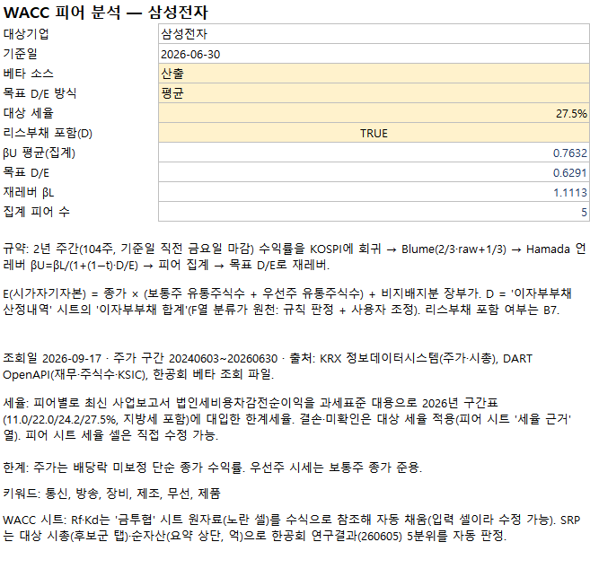
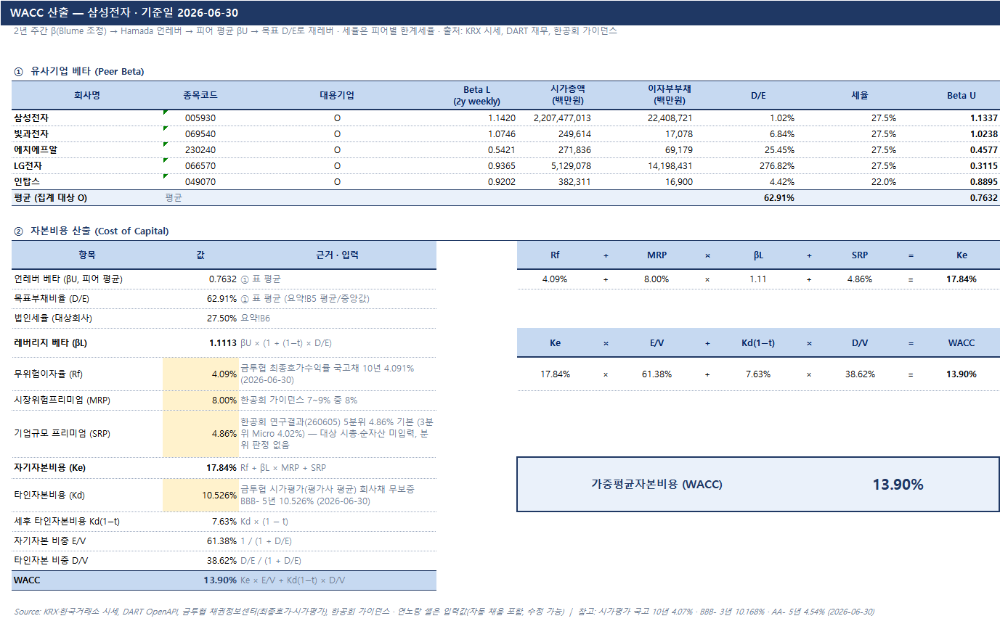
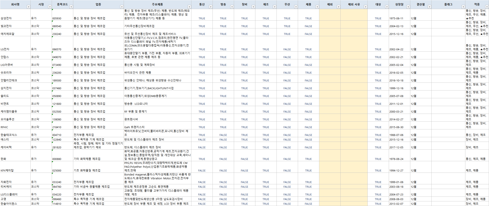
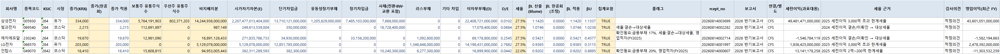
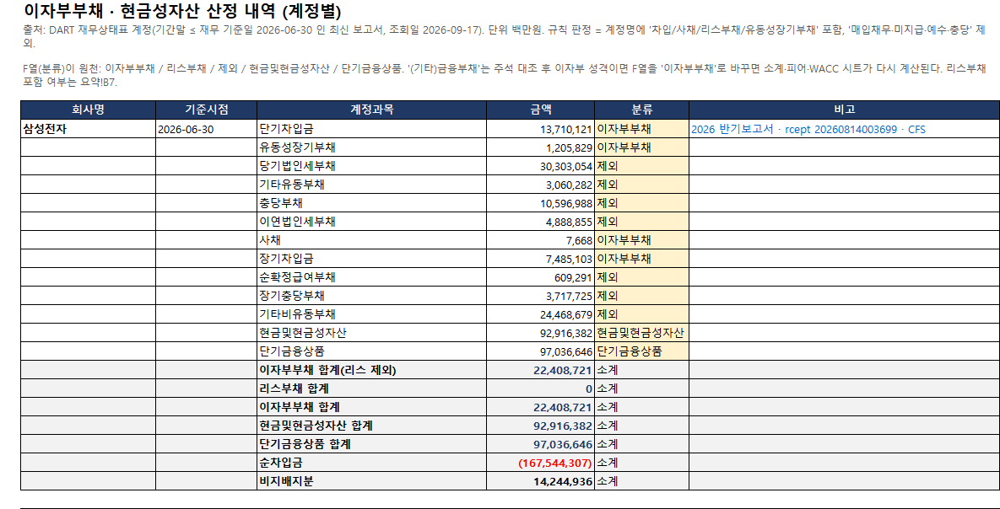
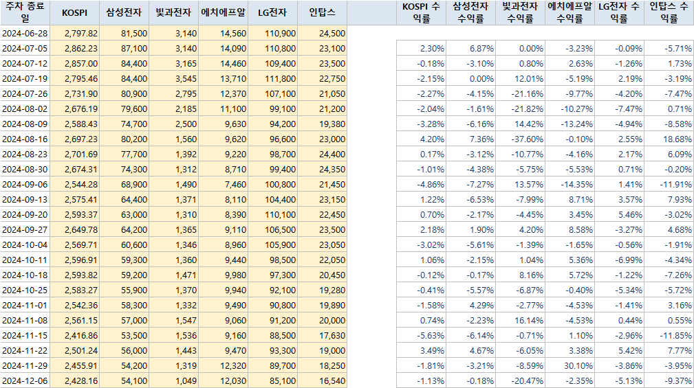
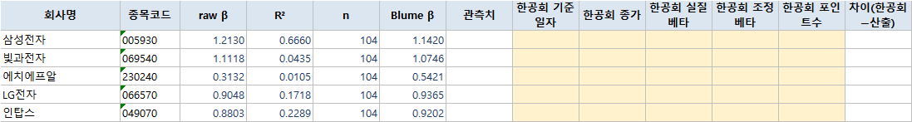
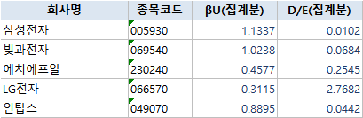
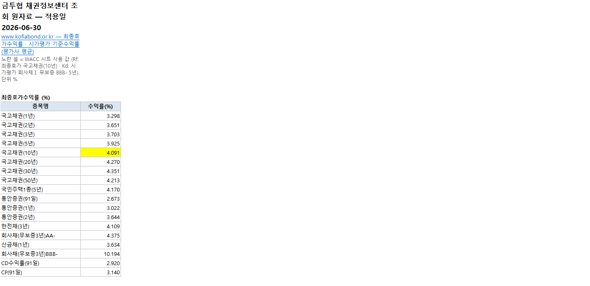

# 엑셀 산출물 — 전체 시트

[README로 돌아가기](../README.md)

삼성전자 예시 산출물 `WACC피어_삼성전자_2026-06-30.xlsx`의 9개 시트를 Microsoft Excel에서 캡처했습니다.
원본은 읽기 전용으로 열고 저장하지 않았습니다. 데이터·수식·저장된 계산값을 유지했으며, 캡처에서 글과 숫자가 잘리지 않도록
표시용 열 너비·행 높이·줄바꿈을 조정했습니다. 긴 시트는 아래의 전체 이미지 링크로 모든 행을 확인할 수 있습니다.

| 시트 | 전체 캡처 범위 | 이미지 |
| --- | --- | --- |
| 요약 | A1:B19 | [전체](img/report/01_summary.png) |
| WACC | A1:N29 | [전체](img/report/02_wacc.png) |
| 후보군 | A1:R555 | [전체 555행](img/report/03_candidates.png) |
| 피어 | A1:AG6 | [전체 33열](img/report/04_peers.png) |
| 이자부부채 산정내역 | A1:G109 | [전체 109행](img/report/05_interest_bearing_debt.png) |
| 주가 | A1:N106 | [전체 106행](img/report/06_prices.png) |
| 베타 | A1:M6 | [전체](img/report/07_beta.png) |
| 목표DE | A1:D6 | [전체](img/report/08_target_de.png) |
| 금투협 | A1:S70 | [전체 70행](img/report/09_kofia.png) |

이자부부채 산정내역의 H:I는 원본에서 숨겨진 계산 보조열이므로 화면에 표시되는 A:G를 캡처했습니다.
원본 파일·이미지 해시, 시트별 범위와 캡처 정보는 [캡처 기록](img/report/manifest.json)에 있습니다.

## 요약

기준일·베타 소스·집계 방식·대상 세율·리스부채 포함 옵션과 계산 결과입니다.

## WACC

피어별 언레버 베타에서 목표 D/E·재레버 베타·자기자본비용·WACC로 이어지는 계산표입니다.

## 후보군

상장사 후보의 업종·제품·키워드 적중·제외 사유를 기록합니다. 아래는 첫 부분이며 [전체 555행 이미지](img/report/03_candidates.png)에 모든 후보가 포함됩니다.

## 피어

주가·유통주식수·시가자기자본·차입 및 리스부채·세율·베타·공시 출처를 나란히 보여줍니다. [전체 33열 이미지 확대](img/report/04_peers.png).

## 이자부부채 산정내역

회사별 계정과 금액, 이자부부채·리스부채·제외·현금성자산 분류 및 소계를 표시합니다. 아래는 첫 부분이며 [전체 109행 이미지](img/report/05_interest_bearing_debt.png)에 모든 피어의 내역이 포함됩니다.

## 주가

KOSPI와 피어의 주간 종가·수익률입니다. 아래는 첫 부분이며 [전체 106행 이미지](img/report/06_prices.png)에서 전체 관측 구간을 확인할 수 있습니다.

## 베타

회귀 베타·R²·표본수·Blume 조정과 한공회 베타 비교입니다. 원본에 값이 없는 한공회 비교 항목은 빈칸으로 유지했습니다.

## 목표DE

집계에 포함되는 피어와 βU·D/E를 표시합니다.

## 금투협

무위험이자율과 타인자본비용에 참조하는 최종호가수익률·시가평가 기준수익률 원자료입니다. 아래는 첫 부분이며 [전체 70행 이미지](img/report/09_kofia.png)에서 전 범위를 확인할 수 있습니다.

